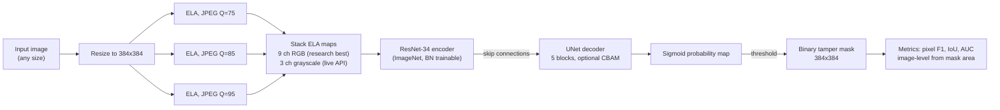
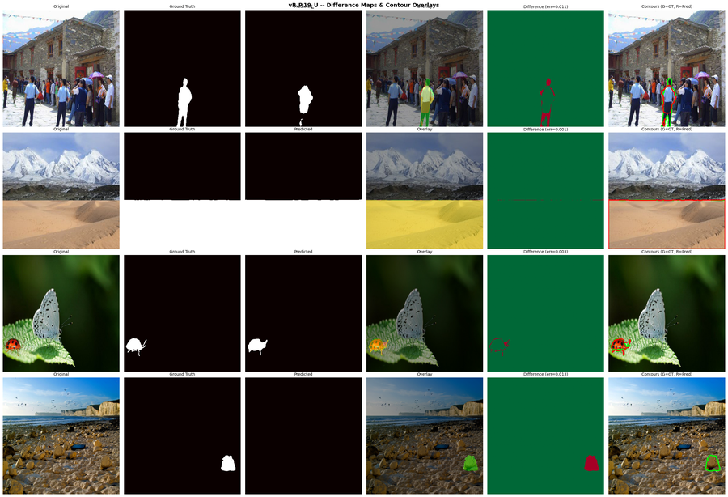
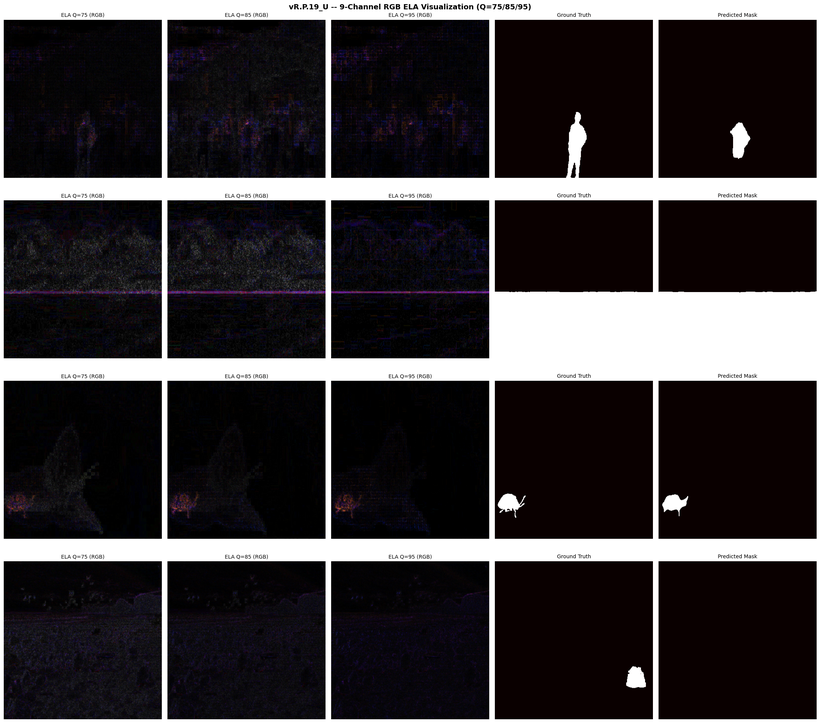
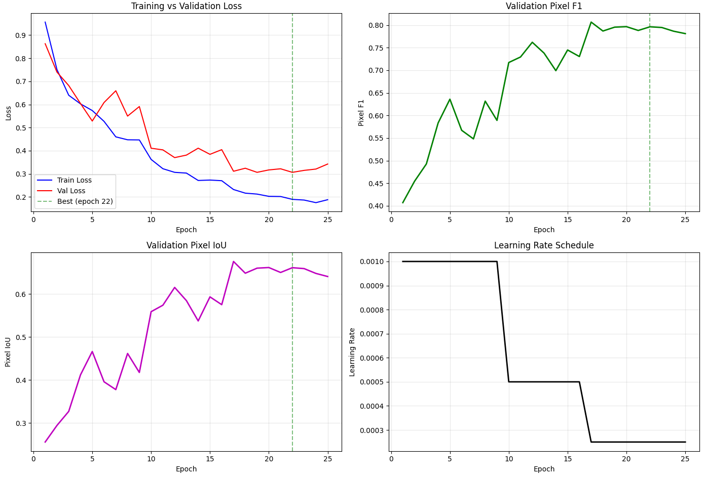
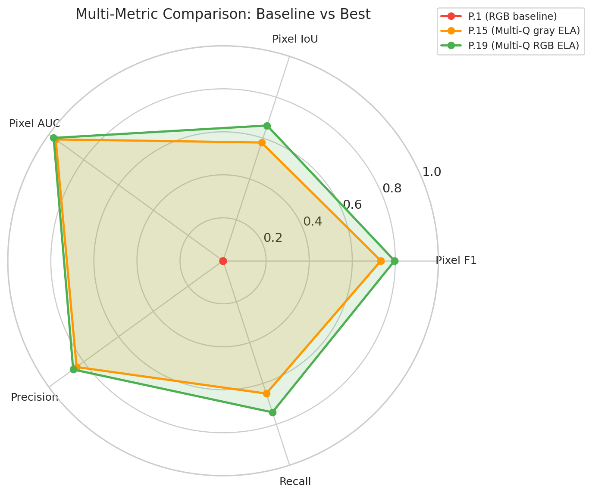
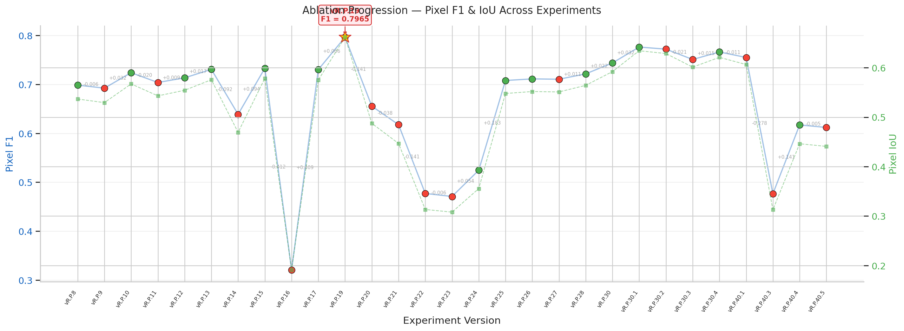
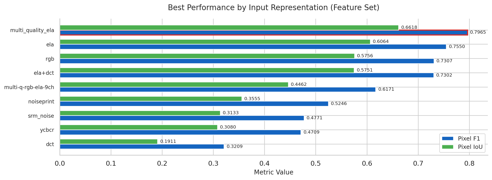

# TIDAL: Tampered Image Detection & Localization

<p align="center">
  
</p>

<p align="center">
  
  
  
  
  
  
  
  
</p>

<p align="center">
  <b>
    <a href="https://the-harsh-vardhan.github.io/TIDAL-Tampered_Image_Detection_And_Localization/">Docs site</a>
    · <a href="https://wandb.ai/tampered-image-detection-and-localization/Tampered%20Image%20Detection%20%26%20Localization/reports/Tampered-Image-Detection-Localization--VmlldzoxNjIyMjMxNg?accessToken=35b8v807ums5jnxtg6z8wieul1ylpetxrv2x4n7k9tr39mwf79ngtqs8w6d6tuaa">W&B Dashboard</a>
    · <a href="submission/submission_report.md">Submission Report</a>
    · <a href="submission/vr-p-19-u-image-tampering-detection-and-localization.ipynb">Final Notebook</a>
    · <a href="docs/ARCHITECTURE.md">Architecture</a>
  </b>
</p>

---

A UNet + ResNet-34 system that finds **which pixels** of an image were tampered with (splicing, copy-move), trained and benchmarked on CASIA v2.0 through 60+ controlled ablation experiments. The best run reaches **Pixel F1 = 0.7965** (IoU 0.6615, AUC 0.9665).

One finding dominated the study: **input representation matters most**. Switching from raw RGB to Multi-Quality RGB ELA gave a **+34.19 pp improvement in Pixel F1** (0.4546 to 0.7965), more than all architectural changes, attention modules and training tricks combined.

> **Keywords:** image forensics · ELA · UNet · ResNet-34 · CASIA 2.0 · ablation study · segmentation · FastAPI · DVC

## What it does

- **Localizes tampering** at pixel level: the output is a 384x384 binary mask of the manipulated region, plus an image-level authentic/tampered decision derived from the mask.
- **Uses Error Level Analysis (ELA) as input**: the image is re-saved as JPEG at Q=75/85/95 and the differences are stacked, so compression inconsistencies in pasted or cloned regions become learnable signal.
- **Documents 60+ single-variable ablations** across four research tracks, tracked in Weights & Biases (input features, attention, losses, augmentation, TTA, DCT features, encoders).
- **Ships as a service**: FastAPI inference backend with analyst threshold controls, a Next.js forensic UI, Docker, Prometheus/Grafana, a DVC training pipeline and CI.

The deployed inference API uses the notebook-derived **vR.P.30.1** pipeline (grayscale Multi-Q ELA + CBAM, forensic controls for thresholding and review triage). The offline leaderboard still shows **vR.P.19** (9-channel RGB Multi-Q ELA) as the strongest benchmarked run.

## Architecture



**ELA** re-saves an image as JPEG at a given quality and measures the difference from the original. Tampered regions show inconsistent compression artifacts; three quality levels (75, 85, 95) capture different compression frequency bands. The research best (vR.P.19) keeps full RGB per quality level (9 channels); the live API (vR.P.30.1) uses grayscale (3 channels) to match its checkpoint. In the best run the encoder's convolutional weights are frozen and only BatchNorm layers train (about 3.17M of 24.4M parameters).

Serving stack:

```text
┌────────────────┐      ┌──────────────────┐
│  Frontend      │──────│  FastAPI Backend  │
│  (Next.js :3000│ POST │  (Uvicorn :8000)  │
│  App Router)   │/infer│                   │
└────────────────┘      │  /health /ready   │
                        │  /infer /metrics  │
                        │  /version         │
                        └────────┬──────────┘
                                 │
                        ┌────────▼──────────┐
                        │ TIDALInference    │
                        │ Engine            │
                        │  ELA -> UNet/R34  │
                        │  -> Mask +        │
                        │  Classify         │
                        └───────────────────┘
```

| Layer | Protection |
| --- | --- |
| Network | CORS whitelist, rate limiting (30 req/min) |
| Input | File type + size (20MB) + resolution (16MP) validation |
| Docker | Non-root user, multi-stage build, read-only mounts |
| CI/CD | pip-audit, ruff bandit rules |
| Model | SHA-256 checkpoint integrity |

## Results

| | |
| --- | --- |
| **Dataset** | CASIA v2.0: 12,614 images (7,491 authentic + 5,123 tampered), stratified 70/15/15 split, seed 42 |
| **Best run** | vR.P.19: Multi-Quality RGB ELA 9-channel, UNet + ResNet-34 |
| **Pixel F1 / IoU / AUC** | **0.7965** / 0.6615 / 0.9665 |

### Ablation: what moved Pixel F1

Source: [`submission/submission_report.md`](submission/submission_report.md). Each experiment changes one variable from its parent.

| Version | What changed | Pixel F1 | IoU | Verdict |
| --- | --- | --- | --- | --- |
| vR.P.1 | RGB baseline (proper GT masks) | 0.4546 | 0.2942 | Baseline |
| vR.P.3 | ELA input replaces RGB | 0.6920 | 0.5291 | Strong + |
| vR.P.7 | Extended training (50 epochs) | 0.7154 | 0.5569 | Positive |
| vR.P.10 | CBAM attention in decoder | 0.7277 | 0.5719 | Positive |
| vR.P.15 | Multi-Quality ELA, grayscale (Q=75/85/95) | 0.7329 | 0.5785 | Positive |
| vR.P.16 | DCT spatial map replaces ELA | 0.3209 | 0.1911 | Negative |
| **vR.P.19** | **Multi-Quality RGB ELA (9ch, full colour)** | **0.7965** | **0.6615** | **Best** |

Impact hierarchy from the report: input representation (ELA, +23.74 pp over RGB) > RGB vs grayscale ELA (+6.36 pp) > multi-quality vs single-Q ELA (+4.09 pp) > CBAM attention (+3.57 pp for about 11K parameters) > training duration/augmentation (+2-3 pp) > loss function (about +0.03 pp). Negative results are kept: DCT-only input (-37.11 pp) and test-time augmentation (-5.32 pp, averaging smooths sharp boundaries).

### Top 5 runs

| Rank | Version | Pixel F1 | Key configuration |
| --- | --- | --- | --- |
| 1 | **vR.P.19** | **0.7965** | Multi-Q RGB ELA 9ch, 25 epochs |
| 2 | vR.P.30.1 | 0.7762 | Multi-Q ELA + CBAM, 50 epochs |
| 3 | vR.P.30.4 | 0.7745 | Multi-Q ELA + CBAM + augmentation |
| 4 | vR.P.30.2 | 0.7721 | Multi-Q ELA + CBAM + unfreeze |
| 5 | vR.P.30 | 0.7714 | Multi-Q ELA + CBAM, 25 epochs |

> **Note on sources.** The tables above follow the submission report. The W&B export in [`experiments/results/leaderboard_results.csv`](experiments/results/leaderboard_results.csv) lists the same vR.P.19 run with IoU 0.6618 and AUC 0.9726, and slightly different values for vR.P.30 and vR.P.30.4. Details on the [results page](docs/results.md).

## Screenshots

Figures extracted from the outputs of the [`vR.P.19_U` notebook](submission/vr-p-19-u-image-tampering-detection-and-localization.ipynb) (the Multi-Q RGB ELA configuration). Columns show original, ground truth, prediction, overlay, difference and contours; the last row is a miss.

<p align="center">
  
</p>

ELA maps at Q=75/85/95 next to the ground-truth and predicted masks:

<p align="center">
  
</p>

Training history (loss, validation Pixel F1, validation IoU, learning-rate schedule):

<p align="center">
  
</p>

Study-wide plots:

<p align="center">
  
</p>
<p align="center">
  
</p>
<p align="center">
  
</p>

## Quickstart

### Run the research notebook

[](https://colab.research.google.com/github/The-Harsh-Vardhan/TIDAL-Tampered_Image_Detection_And_Localization/blob/main/submission/vr-p-19-u-image-tampering-detection-and-localization.ipynb)

### Run the production API

```bash
git clone https://github.com/The-Harsh-Vardhan/TIDAL-Tampered_Image_Detection_And_Localization.git
cd TIDAL-Tampered_Image_Detection_And_Localization
git checkout production
pip install -e ".[dev]"

# Start the backend (CPU mode)
DEVICE=cpu uvicorn backend.app:app --host 0.0.0.0 --port 8000 --reload

# Install frontend dependencies inside Docker (new terminal)
docker run --rm -it \
  -v "${PWD}:/workspace" \
  -w /workspace/frontend \
  node:22-bookworm \
  bash -lc "corepack enable && pnpm install"

# Start the frontend (new terminal)
cd frontend && pnpm dev
```

Open **http://localhost:3000**, drag and drop an image, and use the **Forensic Controls** panel to tighten or relax pixel-level and image-level decision thresholds.

### Tests, lint and DVC pipeline

```bash
pytest tests/ -v         # All tests
ruff check backend/      # Lint
ruff format --check .    # Format check

cd dvc_pipeline
dvc repro                # preprocess -> train -> evaluate -> visualize
```

All hyperparameters live in `dvc_pipeline/params.yaml` (seed 42). GitHub Actions runs on every push/PR to `main` / `production`: `code_quality.yml` (Ruff, pytest, pip-audit) and `docker_build.yml` (Docker build with BuildKit caching).

### Deploy

```bash
# Hugging Face Spaces (backend API, SDK: Docker)
cp deploy/hf-spaces/* .      # then push to your HF Space repo

# Vercel (frontend)
cd frontend && vercel --prod # or connect the repo and set root directory to "frontend/"

# Render (backend): connect the repo and point to deploy/render/render.yaml as Blueprint

# Docker Compose (full stack, local)
cd docker && docker compose up -d
```

Use **CPU Basic** (free) or **T4 GPU** (recommended for real-time inference) on HF Spaces. Set `NEXT_PUBLIC_API_BASE` in `frontend/.env.local` to override the default HF Spaces URL. Compose exposes the API on :8000, the frontend on :3000, Prometheus on :9090 and Grafana on :3001. See [`docs/DEPLOYMENT.md`](docs/DEPLOYMENT.md).

## Project structure

```text
TIDAL/
├── backend/                    # FastAPI inference server
│   ├── app.py                  # 5 endpoints + CORS + Prometheus
│   ├── security.py             # Rate limiting + input validation
│   └── inference/              # Engine, model loader, ELA preprocessing
├── dvc_pipeline/               # Reproducible training pipeline
│   ├── dvc.yaml                # 4-stage DAG
│   ├── params.yaml             # All hyperparameters
│   └── src/                    # Dataset, model, train, evaluate, visualize
├── frontend/                   # Next.js App Router forensic web UI
├── docker/                     # Dockerfile, Dockerfile.dev, docker-compose.yml
├── deploy/                     # HF Spaces, Vercel (legacy), Render configs
├── observability/              # Prometheus + Grafana + alerting
├── tests/                      # pytest suite
├── .github/workflows/          # CI/CD (lint + test + Docker)
├── figures/                    # Plots + logos
├── Notebooks/                  # Research notebooks (60+ experiments)
├── experiments/                # Run notebooks + exported W&B result tables
├── models/inference/           # vR.P.30.1 inference bundle
├── submission/                 # Assignment deliverables
├── docs/                       # GitHub Pages site, architecture, deployment, research notes
├── pyproject.toml              # Project config + ruff rules
├── requirements-prod.txt       # Production dependencies
├── LICENSE                     # MIT
├── CONTRIBUTING.md             # How to contribute
└── SECURITY.md                 # Vulnerability reporting
```

## Research methodology

- **Architecture:** UNet encoder-decoder via [SMP](https://github.com/qubvel/segmentation_models.pytorch), ResNet-34 encoder (ImageNet pretrained)
- **Training:** BCE + Dice hybrid loss, AMP, early stopping (patience 7); the submission report lists Adam (lr 1e-3, weight decay 1e-5) with ReduceLROnPlateau
- **Evaluation:** 70/15/15 stratified train/val/test split with full held-out test metrics
- **Single-variable ablation:** each experiment changes exactly one variable from its parent
- **W&B logging:** all metrics, configs and checkpoints tracked

## Tech stack

| Category | Technologies |
| --- | --- |
| **ML** | PyTorch 2.x · SMP · Albumentations · OpenCV |
| **Backend** | FastAPI · Uvicorn · Prometheus · Pydantic |
| **Frontend** | Next.js App Router · React 19 · Vercel Analytics |
| **Infra** | Docker · Docker Compose · DVC · GitHub Actions |
| **Monitoring** | Prometheus · Grafana · custom alerting rules |
| **Tracking** | Weights & Biases |

## Docs

Full documentation: **https://the-harsh-vardhan.github.io/TIDAL-Tampered_Image_Detection_And_Localization/**

- [Architecture Guide](docs/ARCHITECTURE.md) · [Production Readiness](docs/PRODUCTION_READINESS.md) · [Deployment](docs/DEPLOYMENT.md)
- [Submission Report](submission/submission_report.md) · [Project Lifecycle Tracker](Project_Lifecycle_Tracker.md)
- [W&B Dashboard](https://wandb.ai/tampered-image-detection-and-localization/Tampered%20Image%20Detection%20%26%20Localization/reports/Tampered-Image-Detection-Localization--VmlldzoxNjIyMjMxNg?accessToken=35b8v807ums5jnxtg6z8wieul1ylpetxrv2x4n7k9tr39mwf79ngtqs8w6d6tuaa)

## License

This project is licensed under the [MIT License](LICENSE).

<p align="center">
  Built by <a href="https://github.com/The-Harsh-Vardhan">Harsh Vardhan</a> · IIIT Nagpur
</p>
