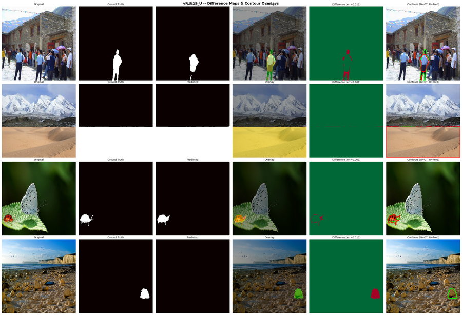

# TIDAL: Tampered Image Detection & Localization

TIDAL finds which pixels of an image were tampered with (splicing, copy-move). It feeds Error Level Analysis (ELA) maps computed at three JPEG qualities into a UNet with a pretrained ResNet-34 encoder and outputs a binary tamper mask. It was benchmarked on CASIA v2.0 through 60+ single-variable ablation experiments tracked in Weights & Biases.

**Best run (vR.P.19):** Pixel F1 0.7965, IoU 0.6615, AUC 0.9665 with 9-channel Multi-Quality RGB ELA. Switching from raw RGB to this input was worth +34.19 percentage points of Pixel F1.

## Pages

- [Pipeline and architecture](pipeline.md): the ELA to UNet to mask flow, and the serving stack
- [Results](results.md): ablation table, top runs, figures, notes on source discrepancies
- [Setup](setup.md): run the API, the frontend, tests and the DVC pipeline
- [Architecture guide](ARCHITECTURE.md), [Production readiness](PRODUCTION_READINESS.md), [Repository structure](Repository_Structure.md)

## Links

- [Source repository](https://github.com/The-Harsh-Vardhan/TIDAL-Tampered_Image_Detection_And_Localization)
- [Submission report](https://github.com/The-Harsh-Vardhan/TIDAL-Tampered_Image_Detection_And_Localization/blob/main/submission/submission_report.md)
- [Deployment guide](https://github.com/The-Harsh-Vardhan/TIDAL-Tampered_Image_Detection_And_Localization/blob/main/docs/DEPLOYMENT.md)
- [W&B dashboard](https://wandb.ai/tampered-image-detection-and-localization/Tampered%20Image%20Detection%20%26%20Localization/reports/Tampered-Image-Detection-Localization--VmlldzoxNjIyMjMxNg?accessToken=35b8v807ums5jnxtg6z8wieul1ylpetxrv2x4n7k9tr39mwf79ngtqs8w6d6tuaa)
