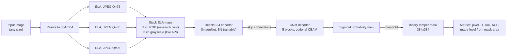
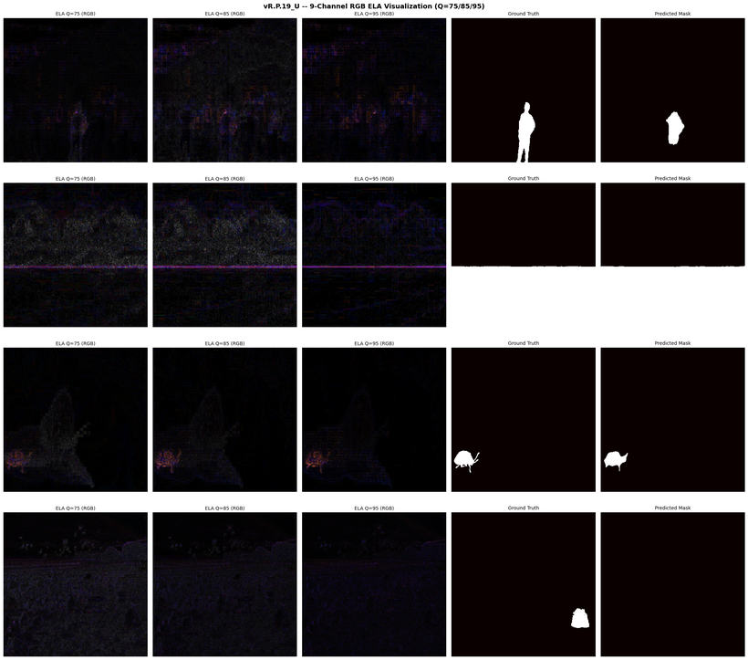

# Pipeline and architecture

## Model pipeline

(GitHub renders the diagram above in the repository README. As text: the image is resized to 384x384, ELA maps are computed at JPEG qualities 75, 85 and 95 and stacked, a UNet with a ResNet-34 encoder produces a sigmoid probability map, a threshold turns it into a binary mask, and pixel F1, IoU and AUC are computed against ground truth.)

## Components

- **ELA preprocessing.** The image is re-saved as JPEG at a given quality and differenced with the original. Q=75, 85 and 95 capture different compression frequency bands. The research best (vR.P.19) keeps RGB per quality (9 channels); the deployed API (vR.P.30.1) uses grayscale (3 channels). Code: `backend/inference/preprocessing.py`.
- **Encoder.** ResNet-34 pretrained on ImageNet; `conv1` is replaced by a 9-channel version initialised by tiling the original weights. In the best run all convolutional weights are frozen and only BatchNorm layers train (about 3.17M of 24.4M parameters).
- **Decoder.** UNet decoder with 5 upsampling blocks (256, 128, 64, 32, 16 channels) and skip connections; the CBAM variants add channel and spatial attention to each block (about 11K parameters).
- **Output.** A single-channel sigmoid mask at 384x384. The API adds a pixel threshold, a minimum-area filter and an image-level decision threshold with a review flag.
- **Training.** BCE + Dice loss, Adam (lr 1e-3), ReduceLROnPlateau, early stopping, AMP; stratified 70/15/15 split with seed 42.

## Serving stack

- **Backend:** FastAPI on Uvicorn (`/health`, `/ready`, `/infer`, `/metrics`, `/version`) with CORS whitelist, rate limiting (30 req/min), file type, size (20MB) and resolution (16MP) validation, and SHA-256 checkpoint integrity.
- **Frontend:** Next.js App Router forensic UI with a Forensic Controls panel for pixel-level and image-level thresholds.
- **Ops:** multi-stage Docker image, Docker Compose with Prometheus and Grafana, DVC pipeline (preprocess, train, evaluate, visualize), GitHub Actions for Ruff, pytest, pip-audit and Docker builds.

See the [architecture guide](ARCHITECTURE.md) and the [repository structure](Repository_Structure.md) for more.
