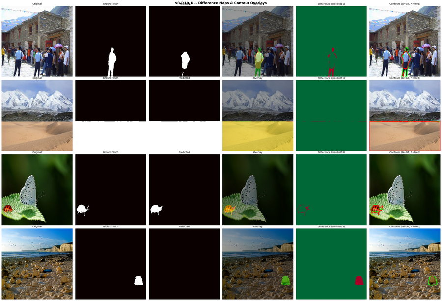
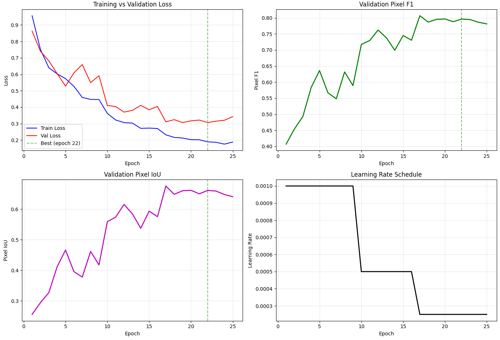
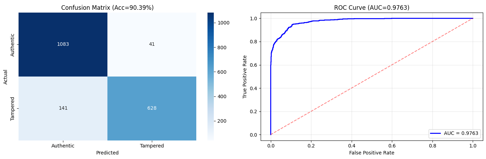
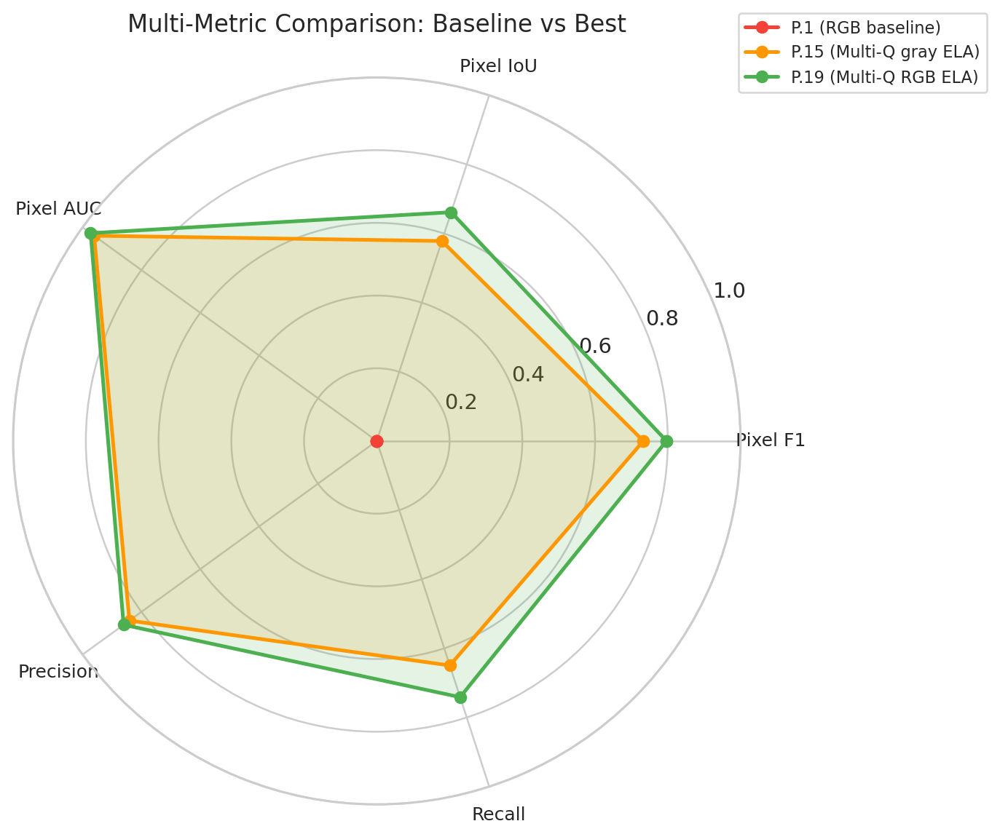
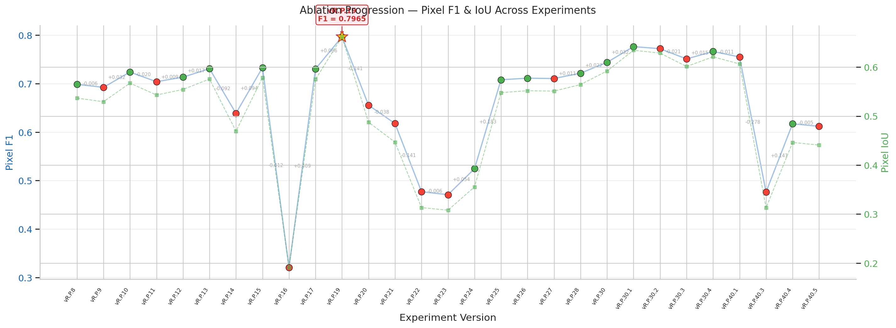

# Results

Dataset: CASIA v2.0, 12,614 images (7,491 authentic, 5,123 tampered: 3,295 copy-move and 1,828 splicing), stratified 70/15/15 split, seed 42.

## Ablation

Source: `submission/submission_report.md`. Each experiment changes one variable from its parent.

| Version | What changed | Pixel F1 | IoU | Verdict |
| --- | --- | --- | --- | --- |
| vR.P.1 | RGB baseline (proper GT masks) | 0.4546 | 0.2942 | Baseline |
| vR.P.3 | ELA input replaces RGB | 0.6920 | 0.5291 | Strong + |
| vR.P.7 | Extended training (50 epochs) | 0.7154 | 0.5569 | Positive |
| vR.P.10 | CBAM attention in decoder | 0.7277 | 0.5719 | Positive |
| vR.P.15 | Multi-Quality ELA, grayscale | 0.7329 | 0.5785 | Positive |
| vR.P.16 | DCT spatial map replaces ELA | 0.3209 | 0.1911 | Negative |
| **vR.P.19** | **Multi-Quality RGB ELA (9ch)** | **0.7965** | **0.6615** | **Best** |

Pixel F1 deltas by change (from the report): RGB channels in ELA +6.36 pp, multi-quality ELA +4.09 pp, ELA + DCT fusion +3.82 pp, CBAM +3.57 pp, extended training +2.34 pp, RGB + ELA fusion +1.33 pp, progressive unfreeze +0.65 pp, data augmentation +0.48 pp, focal + Dice loss +0.03 pp, test-time augmentation -5.32 pp, DCT-only input -37.11 pp.

## Top 5 runs

| Rank | Version | Pixel F1 | Configuration |
| --- | --- | --- | --- |
| 1 | vR.P.19 | 0.7965 | Multi-Q RGB ELA 9ch, 25 epochs |
| 2 | vR.P.30.1 | 0.7762 | Multi-Q ELA + CBAM, 50 epochs |
| 3 | vR.P.30.4 | 0.7745 | Multi-Q ELA + CBAM + augmentation |
| 4 | vR.P.30.2 | 0.7721 | Multi-Q ELA + CBAM + unfreeze |
| 5 | vR.P.30 | 0.7714 | Multi-Q ELA + CBAM, 25 epochs |

## Figures

Extracted from the outputs of the vR.P.19_U notebook.

## Where the numbers disagree

The repository contains more than one set of figures for the best configuration, and they are listed here rather than reconciled:

- **Submission report** (`submission/submission_report.md`, used above and in the README): Pixel F1 0.7965, IoU 0.6615, AUC 0.9665.
- **W&B export** (`experiments/results/leaderboard_results.csv`): the same vR.P.19 run has Pixel F1 0.7965, IoU 0.6618, AUC 0.9726, image accuracy 0.9039. It also lists vR.P.30 at 0.7438 and vR.P.30.4 at 0.7662, against 0.7714 and 0.7745 in the report.
- **vR.P.19_U notebook** (`submission/vr-p-19-u-image-tampering-detection-and-localization.ipynb`): its own test-set output at threshold 0.5 prints Pixel F1 0.8196, IoU 0.6943, AUC 0.9784, precision 0.9137, recall 0.7430; image-level accuracy 90.39%, macro F1 0.8980, ROC-AUC 0.9763. The figures on this page come from that notebook, so they illustrate the configuration, not the exact headline run.

## Earlier classification-only track

The ETASR reproduction track (vR.1.x) could classify but not localize. Its best run, vR.1.6 (deeper CNN), reached 90.23% test accuracy, macro F1 0.9004 and ROC-AUC 0.9657 (`docs/research/ablation_study/experiment_leaderboard.md`).
